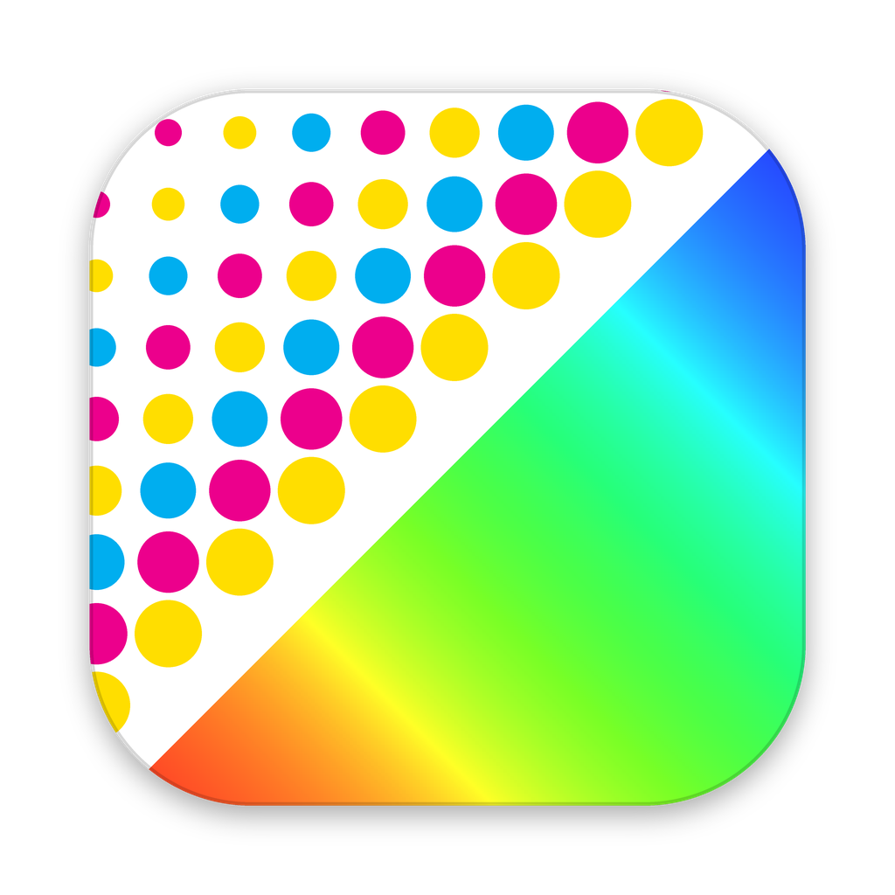

<p align="center"></p>

# Muestras RGB

**Convierte archivos de impresión CMYK (JPG/TIFF) en muestras RGB ligeras y con el color correcto para aprobación del cliente — por lotes y sin abrir Photoshop.**

[Read in English](README.md) · [Guía de uso](docs/guia.md) · [Descarga](#descarga)


Gratis y de código abierto (MIT), de [Estudio Veintidós Lab](https://estudioveintidoslab.com) (e22lab). Interfaz en español e inglés.

## Qué hace

Sueltas una carpeta de archivos de impresión y en unos segundos obtienes:

- **Muestras JPEG en sRGB** con el lado más largo que elijas, a 72 dpi (o los que quieras), ligeras para mandar por correo.
- **Color correcto:** cada archivo se convierte desde **su propio perfil ICC incrustado** (FOGRA39, GRACoL, SWOP…) con intento colorimétrico relativo y compensación de punto negro, no con una conversión ingenua que deja todo verdoso y apagado.
- **Avisos claros** en lugar de sorpresas:
  - un CMYK **sin perfil incrustado** se salta (o se convierte con el perfil que elijas, y queda marcado);
  - un TIFF con **tinta directa** se convierte y queda marcado, porque esa tinta no puede aparecer en una muestra RGB.
- **Renombrado:** prefijo, sufijo, un nombre nuevo para todo el lote, numeración y qué hacer si el archivo ya existe.
- **Marca de agua** (texto o tu logo; al centro, en mosaico o en la esquina).
- **Hoja de contactos en PDF** con todas las muestras, su nombre y su medida de impresión, lista para mandar al cliente.


Tus archivos originales nunca se modifican.

## Descarga

| Sistema | Archivo |
|---|---|
| Windows 10/11 (64 bits) | [MuestrasRGB-windows-x64.zip](https://github.com/fabiannino22/muestras-rgb/releases/latest/download/MuestrasRGB-windows-x64.zip) |
| Mac con chip Apple (M1 en adelante) | [MuestrasRGB-macos-arm64.zip](https://github.com/fabiannino22/muestras-rgb/releases/latest/download/MuestrasRGB-macos-arm64.zip) |
| Mac con procesador Intel | [MuestrasRGB-macos-x64.zip](https://github.com/fabiannino22/muestras-rgb/releases/latest/download/MuestrasRGB-macos-x64.zip) |

No se instala: descomprimes y abres. La app todavía no está firmada, así que la primera vez:

- **Windows:** "Windows protegió tu PC" → *Más información* → *Ejecutar de todas formas*.
- **macOS:** ábrela una vez, cierra el aviso y ve a *Ajustes del Sistema → Privacidad y seguridad* → *Abrir de todos modos*. Si macOS dice que la app "está dañada", ejecuta en Terminal `xattr -dr com.apple.quarantine "/Applications/Muestras RGB.app"`.

Las versiones de Mac son **beta**: se compilan y prueban automáticamente, pero todavía tienen poco uso real. Se agradecen los reportes.

## Uso rápido

1. Arrastra tu carpeta de archivos de impresión a la ventana (o usa *Elegir…*).
2. Ajusta el lado más largo y, si quieres, prefijo/sufijo, marca de agua u hoja de contactos.
3. Da clic en **Convertir** y luego en **Abrir carpeta de salida**.

Por defecto las muestras quedan en una subcarpeta `muestras` dentro de tu carpeta de entrada. La [guía de uso](docs/guia.md) explica cada opción y tiene preguntas frecuentes.

## Archivos compatibles

| Entrada | Resultado |
|---|---|
| JPG/TIFF CMYK con perfil incrustado (8 o 16 bits; TIFF sin comprimir, LZW, ZIP o JPEG; TIFF con capas) | Se convierte desde su perfil a sRGB |
| TIFF con canal de tinta directa | Se convierte, con una nota que nombra la tinta |
| TIFF con canal alfa guardado | Se convierte (el alfa se ignora) |
| CMYK sin perfil incrustado | Se salta con aviso, o se convierte con el perfil que elijas |
| RGB / escala de grises con perfil (p. ej. Adobe RGB) | Se convierte desde su perfil a sRGB |
| RGB / escala de grises sin perfil | Se asume sRGB y se reduce |
| Imágenes con transparencia | Se aplanan sobre blanco |

## Consola

El mismo motor se puede usar desde la terminal (requiere Python 3.10 o más reciente):

```
pip install -r requirements.txt
python exportar_muestras_rgb.py "ruta\de\la\carpeta" --lado 2000 --hoja-contactos "Catálogo otoño"
python exportar_muestras_rgb.py --help
```

## Desde el código / empaquetar

```
pip install -r requirements.txt
python muestras_gui.py                      # la app
python -m unittest discover tests           # pruebas (usan las fixtures TIFF de fixtures/)
pip install pyinstaller && python empaquetar.py   # arma el paquete en dist/
```

Cada push compila y prueba la app empaquetada en Windows, macOS (Apple Silicon) y macOS (Intel) con GitHub Actions. Las notas técnicas (flujo de color, problemas ya resueltos, empaquetado y publicación) están en [docs/tecnico.md](docs/tecnico.md).

## Comentarios

¿Encontraste un problema o tienes una idea? [Abre un issue](https://github.com/fabiannino22/muestras-rgb/issues/new/choose); una captura de la tabla de resultados ayuda mucho.

## Licencia

MIT © Estudio Veintidós Lab (e22lab). Los paquetes incluyen componentes de terceros (Qt/PySide6 con LGPL v3, Pillow, Python y la fuente Inter con OFL); ver `THIRD-PARTY-NOTICES.txt` en la descarga.
