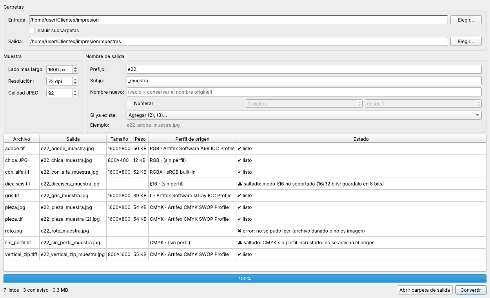

# muestras-rgb

Convierte los **JPG/TIFF de impresión (CMYK)** de una carpeta de cliente en **muestras RGB
reducidas** listas para mandar al cliente a aprobación final, dentro de una subcarpeta
(`muestras/` por defecto). Usa el perfil ICC incrustado de cada pieza como origen, así
que sirve con cualquier perfil de imprenta (FOGRA39, GRACoL, etc.), no solo con uno.

Probado el 2026-09-26 con Python 3.14 y Pillow 12.3.0 en Windows, sobre 15 fondos de
pared de impresión de un cliente (CMYK `Coated FOGRA39 (ISO 12647-2:2004)`,
11221×5315 px @ 150 dpi): 15/15 muestras RGB correctas en 20 s, 7.1 MB en total.

## Qué hay aquí

| Archivo | Qué hace |
|---|---|
| `muestras_gui.py` | **Interfaz gráfica** (prototipo): elige o arrastra la carpeta de entrada, la de salida, tamaño, dpi, calidad, prefijo/sufijo/renombrado y convierte el lote en paralelo con tabla de verificación. |
| `exportar_muestras_rgb.py` | La misma conversión desde consola. |
| `muestras_core.py` | La lógica de color y de nombres que comparten las dos. Solo lectura sobre los originales. |



**Dependencias:** `pip install -r requirements.txt` (Pillow + PySide6; littlecms ya viene
dentro de Pillow). La versión de consola solo necesita Pillow.

## Interfaz gráfica

```
python muestras_gui.py
```

- **Entrada:** carpeta con `.jpg`, `.jpeg`, `.tif` o `.tiff` (se puede arrastrar a la
  ventana). Opcionalmente incluye subcarpetas. Las muestras que ya están dentro de la
  carpeta de salida nunca se reprocesan.
- **Salida:** por defecto `<entrada>/muestras`; se puede elegir cualquier otra.
- **Muestra:** lado más largo (no agranda imágenes más chicas), dpi y calidad JPEG.
- **Nombre:** prefijo, sufijo, nombre nuevo para todo el lote (se numera solo),
  numeración opcional (dígitos y número inicial) y qué hacer si ya existe
  (agregar `(2)`, sobrescribir con confirmación, o saltar). Muestra un ejemplo del
  nombre final y la tabla enseña el nombre de cada archivo antes de convertir.
- Convierte en varios procesos a la vez (hasta 4) sin congelar la ventana, y se puede
  cancelar. Recuerda los ajustes entre sesiones.

## Ejecutables (Windows y macOS)

La GitHub Action `.github/workflows/empaquetar.yml` corre las pruebas, empaqueta con
PyInstaller y **ejecuta el programa ya empaquetado** sobre las fixtures
(`--autoprueba`) en Windows, Mac Apple Silicon y Mac Intel. Los `.zip` quedan como
artefactos de cada run.

Para publicar una versión:

1. Sube `VERSION` en `muestras_core.py` (p. ej. `0.2.0`) y haz commit.
2. `git tag v0.2.0 && git push origin v0.2.0`
3. La Action crea un **release en borrador** con los tres `.zip`; revísalo y publícalo
   desde GitHub. Si la etiqueta no coincide con `VERSION`, falla a propósito.

En local: `pip install -r requirements.txt pyinstaller` y `python empaquetar.py`
(sale en `dist/`). Se usa `PySide6-Essentials` y no `PySide6` completo para no meter
WebEngine, QML y compañía al paquete.

**Mientras no estén firmados** (ver la sección de e22lab), quien lo descargue verá:

- **Windows:** "Windows protegió tu PC" → *Más información* → *Ejecutar de todas formas*.
- **macOS:** "no se puede abrir porque Apple no puede comprobar…" → *Ajustes del Sistema*
  → *Privacidad y seguridad* → *Abrir de todos modos* (solo la primera vez).

## Consola

```
python exportar_muestras_rgb.py                              (sobre la carpeta actual)
python exportar_muestras_rgb.py "G:\ruta\del\cliente"
python exportar_muestras_rgb.py "G:\ruta" --lado 1600 --calidad 85 --dpi 72 --subcarpeta pruebas
python exportar_muestras_rgb.py "G:\ruta" --salida "D:\envios" --prefijo e22_ --sufijo _muestra
```

| Opción | Default | Significado |
|---|---|---|
| `carpeta` (posicional) | `.` | Carpeta que contiene los JPG/TIFF de impresión. |
| `--subcarpeta` | `muestras` | Nombre de la subcarpeta de salida, dentro de `carpeta`. |
| `--salida` | — | Carpeta de salida completa (reemplaza a `--subcarpeta`). |
| `--lado` | `2000` | Píxeles del lado **más largo** de la muestra (respeta la proporción). |
| `--calidad` | `92` | Calidad JPEG. 92 ≈ 500-700 KB/pieza a 2000 px; 85 aligera para envío. |
| `--dpi` | `72` | DPI escrito en los metadatos. No cambia los píxeles, solo la etiqueta. |
| `--prefijo` / `--sufijo` | — | Texto antes / después del nombre original. |
| `--si-existe` | `numerar` | `numerar` (agrega ` (2)`), `sobrescribir` o `saltar`. |

Al terminar imprime una tabla de verificación (dimensiones, peso y perfil de origen
de cada salida) y avisa de cualquier archivo que no procesó.

## Formatos de entrada

Verificado con las variantes de TIFF exportadas desde Photoshop en `fixtures/tiff/`
(ver `fixtures/README.md`). `python -m unittest discover tests` lo comprueba.

| Entrada | Qué pasa |
|---|---|
| CMYK 8 bits con perfil: JPG, o TIFF sin comprimir / LZW / ZIP / JPEG | Se convierte desde su perfil a sRGB (FOGRA39, GRACoL, etc.). |
| CMYK 16 bits con perfil | Se convierte; Pillow lo lee reducido a 8 bits (mismo resultado que el de 8). |
| TIFF con capas | Se usa el compuesto aplanado que Photoshop guarda junto a las capas. |
| TIFF con canal alfa guardado | Se ignora el alfa (no es tinta). |
| TIFF con **tinta directa** | Se convierte **con aviso**: la muestra solo lleva CMYK y no incluye la tinta directa (se nombra en el aviso). |
| CMYK sin perfil | **Se salta con aviso.** |
| RGB con perfil (p. ej. Adobe RGB) | Se convierte desde su perfil a sRGB. |
| RGB sin perfil | Se asume sRGB y solo se reduce. |
| Escala de grises 8 bits (con o sin perfil) | Igual que RGB. |
| Con transparencia (RGBA) | Se aplana sobre blanco. |
| Gris de 16 bits, archivos dañados | Se saltan con aviso. |

## Qué hace por dentro

1. Toma el **perfil ICC incrustado** de cada archivo como origen de color. No hay perfil
   hardcodeado: cada pieza aporta el suyo.
2. **Reduce primero** (LANCZOS al lado mayor pedido) y convierte el perfil después.
   La conversión ICC es por píxel independiente, así que el color sale igual pero
   ~30× más rápido que convertir los ~60 MP originales.
3. Convierte a **sRGB** con littlecms, intento *Relative Colorimetric* + compensación
   de punto negro.
4. Guarda JPEG progresivo y optimizado con el perfil sRGB incrustado y el dpi pedido.

## Reglas de seguridad

- **Nunca toca los originales:** solo escribe dentro de la carpeta de salida.
- Una **tinta directa no se puede simular** en la muestra: Pillow lee solo los 4 canales
  CMYK y descarta los extra. Para no perderla en silencio se lee el recurso DisplayInfo
  (`0x0435`) que Photoshop guarda en el TIFF, que distingue alfa (tipo 0/1) de tinta
  directa (tipo 2), y se avisa con su nombre.
- Un **CMYK sin perfil incrustado se salta con aviso**, porque sin origen no hay forma
   honesta de convertir el color. Mejor un aviso que un color inventado.
- Un archivo que ya es RGB se reconvierte desde su perfil a sRGB (o solo se reduce si no
   trae perfil).

## Gotchas de color verificados (no volver a descubrirlos)

- El JPEG CMYK de Photoshop viene con `adobe_transform=2` (YCCK con canales invertidos).
  Pillow lo decodifica bien solo: **no invertir los canales a mano**.
- Con FOGRA39, *Relative Colorimetric* y *Perceptual* dan resultado **idéntico**
  (diferencia media 0.0/255): la elección de intento no importa con este perfil.
- `img.convert("RGB")` **sin ICC** sale visiblemente más verde y apagado. Nunca omitir
  el perfil incrustado.
- `Image.MAX_IMAGE_PIXELS = None` es obligatorio: las piezas de impresión (~60 MP)
  superan el límite anti-"image bomb" de Pillow y sin eso abre con excepción.
- **sRGB es el destino correcto para aprobar en pantalla.** Adobe RGB sin gestión de
  color se ve saturado y engañoso en el monitor del cliente.
- El **dpi de los metadatos no cambia los píxeles**: 2000 px son 2000 px en pantalla.
  Solo afecta a cómo lo interpreta un programa que mida en cm/pulgadas.
- Una muestra CMYK→RGB es una **simulación de cómo se verá impreso**, no el RGB
  original del diseño. Si el cliente compara contra un PNG RGB anterior, notará
  ligeras diferencias en los tonos más saturados: es el gamut de la imprenta, no un bug.

## Dónde vive y por qué

- El código vive aquí, en OneDrive, porque es una herramienta **transversal del
  estudio**, no de un cliente: cualquier carpeta de impresión de cualquier cliente se
  procesa apuntándola por argumento.
- Las **muestras salen dentro de la carpeta del cliente** (subcarpeta `muestras/`),
  porque son el entregable que se envía; no se acumulan aquí.

## A futuro: Estudio Veintidós Lab / e22lab (apuntado 2026-09-26, sin fecha)

La visión es convertir esto en una **herramienta gratuita de distribución pública**
bajo el sello **Estudio Veintidós Lab** (`e22lab`, dominio
`estudioveintidoslab.com`), para que cualquier diseñador que imprima se salte el
tener que programar un lote de acciones en Photoshop o convertir a mano.

Orden previsto (cada paso desbloquea el siguiente):

1. **Repo versionado** (este): semilla y backup. Hoy privado/interno.
2. **Ejecutable drag & drop** (PyInstaller + una GUI mínima): es el paso que de verdad
   la vuelve usable para quien no abre una consola. Sin esto, la adopción externa es
   cercana a cero.
3. **Video demo + landing de e22lab**: rinden después del ejecutable, no antes; un
   video de "suelta tu carpeta de CMYK, recibe tus muestras RGB" es lo que convierte.
4. **Más repos de e22lab**: irán saliendo de `studio-lab` (QC de entregas, PSD→spec)
   cuando cada uno tenga readme y ejemplo propios.

**Mientras no exista el ejecutable, esto NO se publica:** queda privado como el resto
de herramientas del estudio. Antes de cualquier publicación: licencia elegida (MIT si
se mantiene gratuita), readme sin nombres de clientes, y cero rutas locales.
