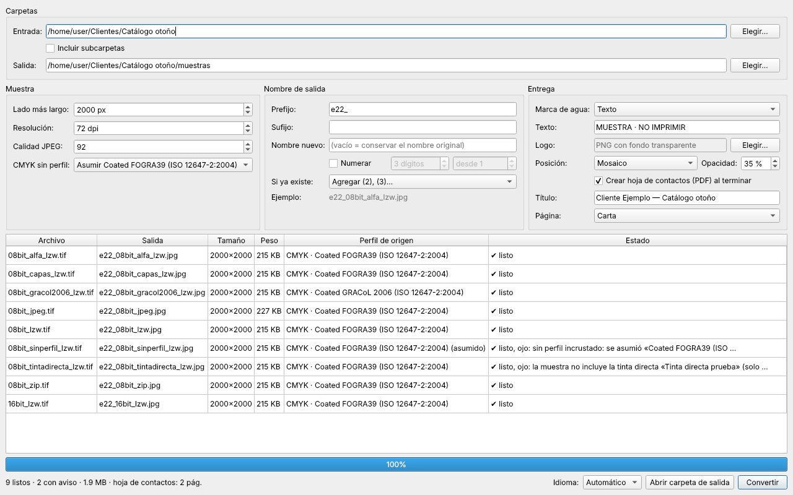
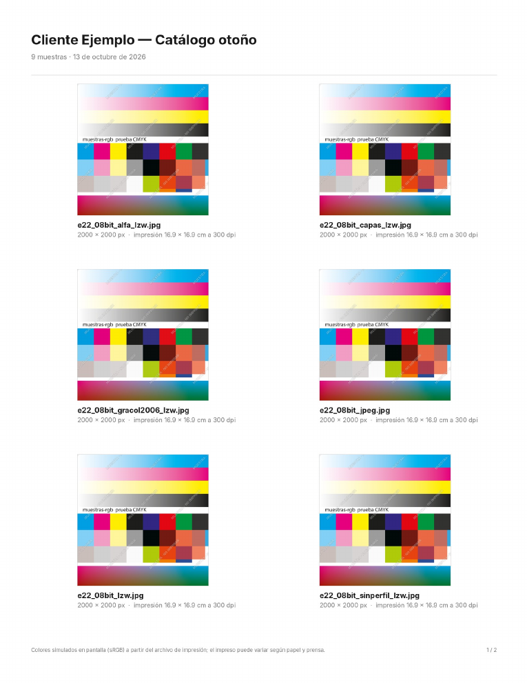

# Guía de uso · Muestras RGB

[Read in English](guide.md) · [Volver al inicio](../README.es.md)

Muestras RGB convierte archivos de impresión (JPG o TIFF, normalmente en CMYK) en muestras JPEG en RGB, ligeras y con el color bien convertido, para que el cliente las apruebe en pantalla. Tus originales **nunca se modifican**: todo se escribe en la carpeta de salida.

## 1. Carpetas

- **Entrada:** la carpeta con tus archivos `.jpg`, `.jpeg`, `.tif` o `.tiff`. Puedes arrastrarla a la ventana o usar *Elegir…*. Si arrastras un archivo, se usa la carpeta donde está.
- **Incluir subcarpetas:** también procesa los archivos de las carpetas que hay dentro.
- **Salida:** dónde se guardan las muestras. Por defecto es una subcarpeta `muestras` dentro de la entrada; puedes elegir cualquier otra. Las muestras que ya están en la carpeta de salida nunca se vuelven a procesar.

La tabla muestra todos los archivos encontrados y, antes de convertir, el nombre que tendrá cada muestra.

## 2. Muestra

| Opción | Qué hace |
|---|---|
| **Lado más largo** | Tamaño en píxeles del lado mayor; el otro se ajusta en proporción. Las imágenes más chicas no se agrandan. 2000 px se ven bien a pantalla completa. |
| **Resolución** | El dpi escrito en el archivo (72 por defecto). **No cambia los píxeles**, solo la etiqueta: 2000 px son 2000 px en pantalla. |
| **Calidad JPEG** | 92 da muestras de unos 500-700 KB a 2000 px; 85 las aligera para correo con poca diferencia visible. |
| **CMYK sin perfil** | Qué hacer con un CMYK que no trae perfil incrustado (ver la sección 5). |

## 3. Nombre de salida

- **Prefijo / Sufijo:** texto antes o después del nombre. `e22_` + `portada` + `_muestra` → `e22_portada_muestra.jpg`.
- **Nombre nuevo:** reemplaza el nombre original de todo el lote y numera solo: `Catálogo_001.jpg`, `Catálogo_002.jpg`…
- **Numerar:** agrega `_001`, `_002`… al nombre original. Puedes elegir los dígitos y desde qué número empezar.
- **Si ya existe:**
  - *Agregar (2), (3)…* (por defecto): no sobrescribe nada.
  - *Sobrescribir*: reemplaza la muestra anterior; pide confirmación.
  - *Saltar*: deja la que ya existe y no convierte ese archivo.

**Ejemplo** muestra cómo quedará el primer nombre.

## 4. Entrega

### Marca de agua
- **Texto** (por defecto "MUESTRA · NO IMPRIMIR") o **Logo** (un PNG con fondo transparente).
- **Posición:** *Centro, en diagonal* (la más difícil de recortar), *Mosaico* (repetida en toda la imagen) o *Esquina* (discreta, abajo a la derecha).
- **Opacidad:** 35 % se lee sin tapar el diseño.

El texto es blanco con contorno oscuro para que se lea sobre fondos claros y oscuros.

### Hoja de contactos
Marca *Crear hoja de contactos (PDF) al terminar* para obtener `<título> - hoja de contactos.pdf` en la carpeta de salida:

- seis muestras por página, en **Carta** o **A4**;
- nombre de cada muestra, píxeles y **medida de impresión** del original (p. ej. "29.7 × 42.0 cm a 300 dpi");
- una nota al pie que aclara que los colores son una simulación en pantalla.

La hoja solo incluye notas **útiles para el cliente**, como que una pieza lleva una tinta directa que no se puede simular. Los avisos técnicos (por ejemplo, qué perfil se asumió) se quedan en la app.

## 5. Avisos y archivos saltados

Al convertir, la columna **Estado** dice qué pasó con cada archivo:

| Estado | Qué significa | Qué hacer |
|---|---|---|
| ✔ listo | Convertido sin observaciones. | Nada. |
| ✔ listo, ojo: *sin perfil incrustado: se asumió…* | Era CMYK sin perfil y se usó el perfil que elegiste en *CMYK sin perfil*. | Confirma con quien hizo el archivo qué perfil usó. |
| ✔ listo, ojo: *no incluye la tinta directa…* | El TIFF tiene una tinta directa (Pantone, barniz, blanco…). La muestra solo lleva CMYK. | Avísale al cliente; la hoja de contactos ya lo menciona. |
| ⚠ saltado: *CMYK sin perfil incrustado* | No hay forma honesta de saber cómo se ve ese CMYK. | Incrusta el perfil al exportar, o elige un perfil en *CMYK sin perfil*. |
| ⚠ saltado: *modo … no soportado* | Por ejemplo, un gris de 16 bits. | Guárdalo en 8 bits. |
| ✖ error: *no se pudo leer* | El archivo está dañado o no es una imagen. | Vuelve a exportarlo. |

## 6. Idioma

Abajo a la derecha, **Idioma**: *Automático* (sigue al sistema), *Español* o *English*. El cambio se aplica al momento.

## Preguntas frecuentes

**¿Por qué el color de la muestra no es igual al de mi diseño en RGB?**
Porque la muestra simula **cómo se verá impreso**: parte del archivo CMYK de imprenta, y la tinta no alcanza algunos colores muy saturados de la pantalla (el *gamut*). Eso no es un error; es justo lo que el cliente debe aprobar.

**¿Qué perfil elijo para un CMYK sin perfil?**
El que usó quien preparó el archivo. Si no lo sabes: en México y EE. UU. Photoshop suele usar *U.S. Web Coated (SWOP) v2*; en Europa, *Coated FOGRA39*. La lista muestra los perfiles CMYK instalados en tu computadora; con Adobe instalado aparecen los de Adobe.

**¿Por qué 72 dpi?**
Por costumbre: el dpi no afecta cómo se ve en pantalla. Lo que importa es el tamaño en píxeles (*Lado más largo*).

**¿Se modifican mis archivos originales?**
No. Solo se escribe en la carpeta de salida.

**¿Funciona con PDF, PSD o AI?**
Todavía no. Exporta a JPG o TIFF desde tu programa (con el perfil incrustado).

**Mi archivo tiene capas, ¿sirve?**
Sí. En un TIFF con capas se usa la imagen aplanada que Photoshop guarda junto a las capas.

**Windows o macOS no me dejan abrir la app.**
Es porque todavía no está firmada. Ver las instrucciones de [Descarga](../README.es.md#descarga).

¿Algo no funciona como esperabas? [Abre un issue](https://github.com/fabiannino22/muestras-rgb/issues/new/choose) con una captura de la tabla.
