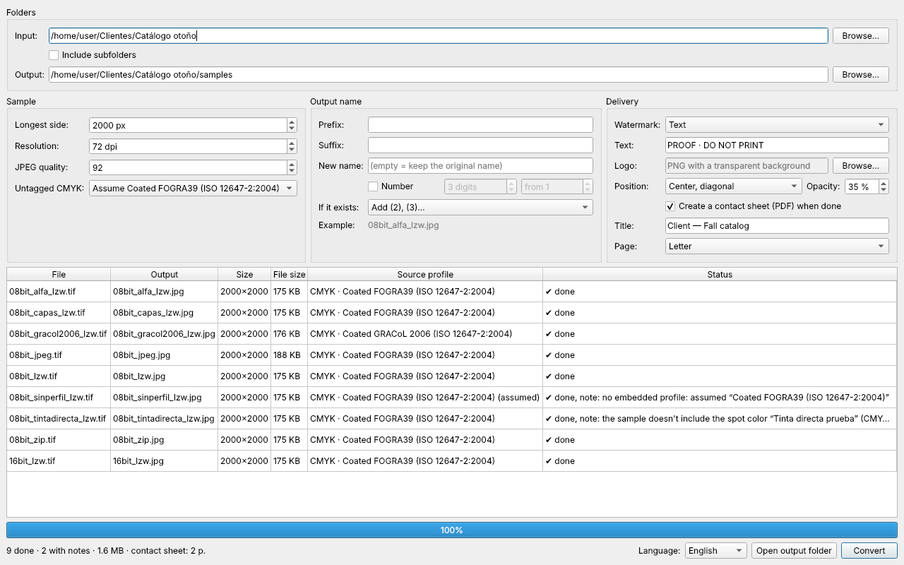
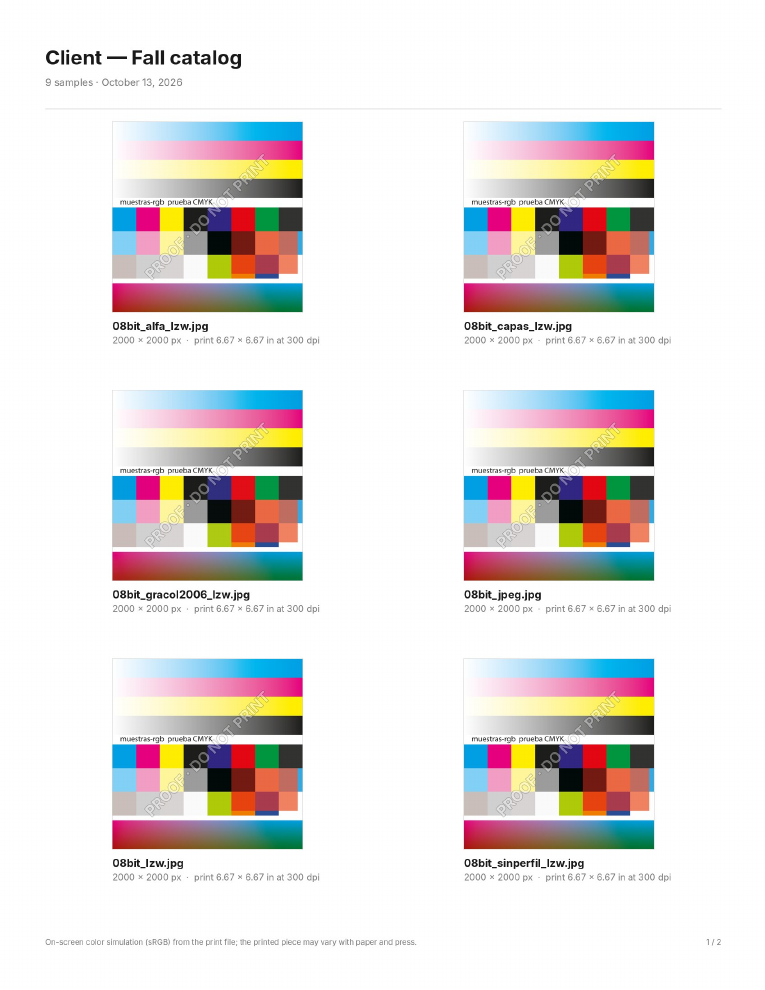

# User guide · Muestras RGB

[Leer en español](guia.md) · [Back to the start](../README.md)

Muestras RGB turns print files (JPG or TIFF, usually CMYK) into RGB JPEG samples that are light and correctly color-converted, so your client can approve them on screen. Your originals are **never modified**: everything is written to the output folder.

## 1. Folders

- **Input:** the folder with your `.jpg`, `.jpeg`, `.tif` or `.tiff` files. Drag it onto the window or use *Browse…*. If you drop a file, its folder is used.
- **Include subfolders:** also processes files in folders inside it.
- **Output:** where the samples are saved. By default, a `samples` subfolder inside the input folder; you can choose any other. Samples already in the output folder are never processed again.

The table lists every file found and, before converting, the name each sample will get.

## 2. Sample

| Option | What it does |
|---|---|
| **Longest side** | Size in pixels of the longer side; the other follows the proportion. Smaller images are never enlarged. 2000 px looks good full-screen. |
| **Resolution** | The dpi written into the file (72 by default). It **doesn't change the pixels**, only the label: 2000 px are 2000 px on screen. |
| **JPEG quality** | 92 gives samples of about 500-700 KB at 2000 px; 85 makes them lighter for email with little visible difference. |
| **Untagged CMYK** | What to do with a CMYK file that has no embedded profile (see section 5). |

## 3. Output name

- **Prefix / Suffix:** text before or after the name. `e22_` + `cover` + `_proof` → `e22_cover_proof.jpg`.
- **New name:** replaces the original name for the whole batch and numbers automatically: `Catalog_001.jpg`, `Catalog_002.jpg`…
- **Number:** adds `_001`, `_002`… to the original name. Choose the digits and the starting number.
- **If it exists:**
  - *Add (2), (3)…* (default): nothing is overwritten.
  - *Overwrite*: replaces the previous sample; asks for confirmation.
  - *Skip*: keeps the existing one and doesn't convert that file.

**Example** shows what the first name will look like.

## 4. Delivery

### Watermark
- **Text** (default "PROOF · DO NOT PRINT") or **Logo** (a PNG with a transparent background).
- **Position:** *Center, diagonal* (hardest to crop out), *Tiled* (repeated over the whole image) or *Corner* (discreet, bottom right).
- **Opacity:** 35 % is readable without hiding the design.

The text is white with a dark outline so it reads on both light and dark backgrounds.

### Contact sheet
Check *Create a contact sheet (PDF) when done* to get `<title> - contact sheet.pdf` in the output folder:

- six samples per page, **Letter** or **A4**;
- each sample's name, pixel size and the original's **print size** (e.g. "11.69 × 16.54 in at 300 dpi");
- a footer noting that colors are an on-screen simulation.

The sheet only includes notes that are **useful to the client**, such as a piece using a spot color that can't be simulated. Technical notes (e.g. which profile was assumed) stay in the app.

## 5. Notes and skipped files

After converting, the **Status** column tells you what happened to each file:

| Status | Meaning | What to do |
|---|---|---|
| ✔ done | Converted, nothing to report. | Nothing. |
| ✔ done, note: *no embedded profile: assumed…* | It was untagged CMYK and the profile chosen in *Untagged CMYK* was used. | Check with whoever made the file which profile they used. |
| ✔ done, note: *doesn't include the spot color…* | The TIFF has a spot color (Pantone, varnish, white…). The sample only has CMYK. | Tell the client; the contact sheet already mentions it. |
| ⚠ skipped: *untagged CMYK* | There's no honest way to know what that CMYK looks like. | Embed the profile when exporting, or pick a profile in *Untagged CMYK*. |
| ⚠ skipped: *… mode is not supported* | For example, 16-bit grayscale. | Save it as 8-bit. |
| ✖ error: *couldn't read it* | The file is damaged or isn't an image. | Export it again. |

## 6. Language

Bottom right, **Language**: *Automatic* (follows your system), *Español* or *English*. It applies immediately.

## FAQ

**Why doesn't the sample's color match my RGB design?**
Because the sample simulates **how it will look printed**: it starts from the CMYK print file, and ink can't reach some very saturated screen colors (the *gamut*). That's not a bug; it's exactly what the client should approve.

**Which profile should I pick for untagged CMYK?**
The one used by whoever prepared the file. If you don't know: in North America Photoshop usually uses *U.S. Web Coated (SWOP) v2*; in Europe, *Coated FOGRA39*. The list shows the CMYK profiles installed on your computer; with Adobe installed, Adobe's appear.

**Why 72 dpi?**
Habit: dpi doesn't affect how it looks on screen. What matters is the pixel size (*Longest side*).

**Are my original files changed?**
No. Only the output folder is written to.

**Does it work with PDF, PSD or AI?**
Not yet. Export to JPG or TIFF from your app (with the profile embedded).

**My file has layers — does that work?**
Yes. For a layered TIFF, the flattened image Photoshop saves alongside the layers is used.

**Windows or macOS won't let me open the app.**
That's because it isn't code-signed yet. See the [Download](../README.md#download) instructions.

Something not working as expected? [Open an issue](https://github.com/fabiannino22/muestras-rgb/issues/new/choose) with a screenshot of the table.
